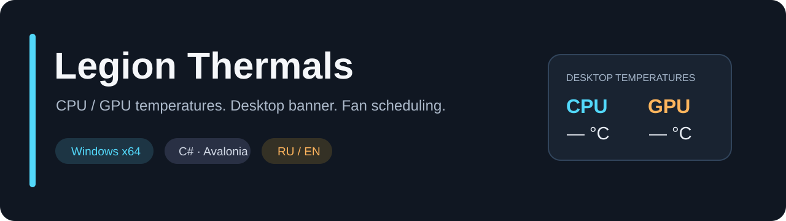

# Legion Thermals



[](https://github.com/knvnano/legion-thermals/actions/workflows/build.yml)
[](https://github.com/knvnano/legion-thermals/releases/latest)
[](LICENSE)

**CPU/GPU temperatures on your desktop, plus temperature-based fan control for supported Lenovo Legion laptops.** Built with C# and Avalonia, using Windows APIs directly. English and Russian interfaces.

[Download for Windows x64](https://github.com/knvnano/legion-thermals/releases/latest) · [Русская инструкция](README.ru.md) · [Compatibility](docs/HARDWARE.md) · [How the code works](docs/ARCHITECTURE.md)

## Download and run

Open **[Releases](https://github.com/knvnano/legion-thermals/releases/latest)** and choose:

- **LegionThermals-Setup-1.3.0-win-x64.exe** — installer with .NET included; easiest option.
- **LegionThermals-1.3.0-win-x64-portable.zip** — self-contained portable folder; extract everything before running `LegionThermals.exe`.
- **SHA256SUMS.txt** — checksums for verifying either download.

Windows 10/11 x64 is required. The executable requests administrator access through Windows UAC because Lenovo WMI requires it on the validated laptop. Binaries are unsigned. If Windows blocks an unsigned download, make your own trust decision; review the source and checksum before running it.

For an update, use the old tray menu → **Exit**, then install or replace the complete portable folder. Settings survive updates. Start the new copy once so an existing startup task can update its executable path.

## Features

- A small draggable, translucent **always-on-top banner**, with configurable opacity and screen position.
- **One tray icon**: CPU above GPU, or the app icon; right-click for settings and Exit.
- Measured CPU/GPU temperatures and fan RPM, distinct from requested firmware targets.
- A manual minimum fan-speed slider and a **temperature → speed table**, with 30–100% in steps of 10%.
- A scheduler checkbox; rows can be added and removed. It uses `max(CPU, GPU)`, polls every two seconds and adds 3 °C cooling hysteresis.
- **English / Русский** language button in Settings; switching is immediate and saved.
- Automatic settings persistence with atomic writes and a backup.
- Optional **elevated startup at sign-in** through Windows Task Scheduler, without storing a password or requiring a new UAC prompt at each sign-in.
- No extra sensor library, service, bundled kernel driver, telemetry or account. Avalonia and its normal UI dependencies are included.

## Hardware compatibility

| Feature | Validated hardware |
| --- | --- |
| Temperatures and measured RPM | Lenovo 83DF, Legion Pro 5 16IRX9, BIOS N0CN32WW |
| Fan-curve writes and full-speed override | Same model / N0CN firmware family; only N0CN32WW physically tested |
| Other models | Temperature fallback may work; fan writes remain disabled |

**This is not a universal laptop fan controller.** Marketing names such as Y9000 can cover different hardware. Check your machine type and BIOS. See [hardware details and protocol](docs/HARDWARE.md).

Fan percentages are a **minimum curve floor**, rounded up to a firmware level, not a fixed RPM or a cap on cooling. Manual/table mode selects Lenovo **Custom**, which is also a performance mode. CPU ≥90 °C or GPU ≥80 °C requests the maximum curve regardless of the table. Missing temperatures restore Auto; an external mode change such as Fn+Q disables app control.

**Lenovo Auto** and normal Exit restore the original mode, curve and full-speed flag. A recovery journal handles a previous crash at the next administrator launch; forced termination cannot restore cooling immediately. Do not use this app as an emergency thermal-protection system.

## Quick setup

1. Launch the app, approve Windows UAC and open Settings from the tray icon.
2. Choose the interface language, banner position/opacity and tray display.
3. For automatic fans, edit the temperature table and enable the scheduler. Invalid edits show a message and leave the last valid table active.
4. Enable elevated startup if wanted. It creates `LegionThermals-<your SID>` for your interactive administrator account, with a 10-second sign-in delay.
5. Use **Lenovo Auto** to hand control back to the original settings. Closing Settings keeps the tray app running; use **Exit** to stop it.

Settings: `%LOCALAPPDATA%\LegionThermals\settings.json`; previous version: `settings.json.bak`. A task is created only after opting in. The installer does not silently enable startup.

## Build from source

Install the [.NET 10 SDK](https://dotnet.microsoft.com/download/dotnet/10.0) on Windows:

```powershell
dotnet restore LegionThermals/LegionThermals.csproj
dotnet build LegionThermals/LegionThermals.csproj -c Release
dotnet run --project LegionThermals.Tests -c Release
dotnet publish LegionThermals/LegionThermals.csproj -c Release -r win-x64 --self-contained true -o artifacts/portable
```

For the installer, install [NSIS 3](https://nsis.sourceforge.io/Download), then run:

```powershell
pwsh -File LegionThermals/installer/Build-Installer.ps1 -Version 1.3.0
```

The build collects third-party license notices into the release. See [development and architecture](docs/ARCHITECTURE.md) and [contributing](CONTRIBUTING.md). Source comments explain each major block in Russian; architecture documentation is in English.

## Troubleshooting and diagnostics

- **Unavailable temperatures (`—`)**: confirm elevation and model/BIOS compatibility. The diagnostic command `LegionThermals.exe --diagnose` writes `diagnostics.txt` next to the executable.
- **Fan speed stuck at maximum**: the app clears and later restores the separate Lenovo full-speed override when it owns manual control. Check measured RPM and the status message, not just the requested percentage.
- **No visible tray icon**: check the Windows notification overflow menu.
- **Banner covered by a fullscreen app**: exclusive fullscreen and the secure UAC desktop can cover normal topmost windows.

Optional read-only PowerShell diagnostics are in `LegionThermals/diagnostics/Collect-FanDiagnostics.ps1`. Do not attach raw firmware dumps, full diagnostics or private paths to a public issue without reviewing them. See [SECURITY.md](SECURITY.md).

## Testing and license

262 automated checks cover temperature validation, error guidance, curve encoding, scheduling/hysteresis, settings recovery and language persistence. On-device tests verified measured RPM rising and falling through 40 → 80 → 40%, restoration, and real elevated Task Scheduler execution. CI does not change hardware settings. UI language checks are recorded in release notes.

[MIT licensed](LICENSE). .NET, Avalonia and other bundled components retain their own licenses; see `THIRD-PARTY-NOTICES.txt` and `Licenses/` in downloads. This independent project is not affiliated with Lenovo.
